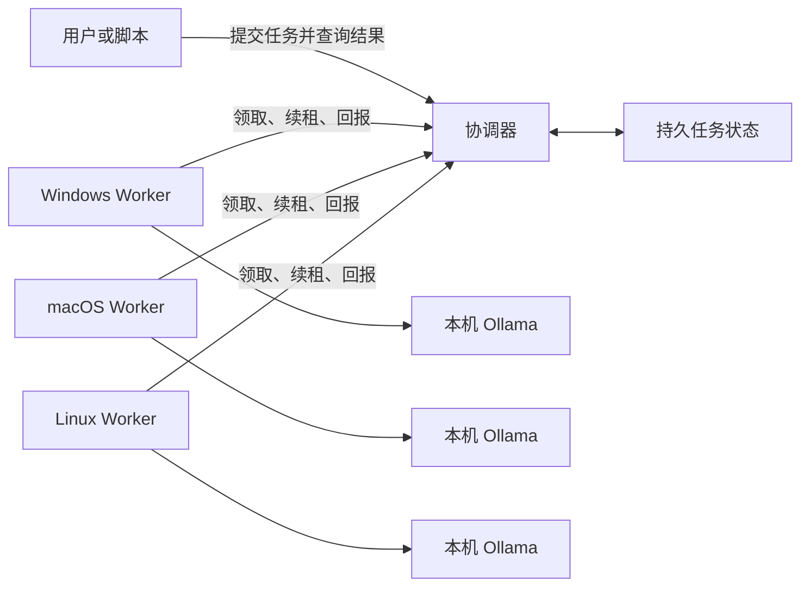

# 架构与实施路线

## 如何利用闲置电脑

IdleMesh AI 把每个文本生成请求作为独立任务。一台安装了模型的电脑用自己的 CPU 和内存完成一个任务，多台电脑同时处理队列中的不同任务。模型权重留在各节点本地，网络主要传输提示词、结果和少量调度消息。增加同模型节点可以提高批量请求的并发能力，并为故障重试提供候选节点。每个节点仍需要足够的内存装下所选模型和上下文。

Worker 主动连接协调器。只要 Worker 能访问协调器，参与运算的电脑就可以保留原来的入站防火墙设置。跨家庭或办公室试点可以使用双方都能访问的私有网络或 VPN。节点上的 Ollama 使用本机回环地址。 [Ollama API 文档](https://docs.ollama.com/api/generate)

## 任务如何恢复

1. 协调器持久保存新任务，客户端以任务 ID 查询进度和结果。状态包含已使用的尝试次数和最近一次执行的 Worker ID。单机模式写入本地 bbolt 数据库，集群模式由 Raft 多数派提交后确认。
2. Worker 确认本机资源符合接单条件后，从协调器领取与自己支持的模型匹配的任务。协调器给本次执行发放限时租约。
3. Worker 推理期间续租。如果电脑睡眠、退出或失去连接，协调器在租约到期后允许可用节点重新领取任务，直到用完尝试次数。
4. 新节点从原始提示词重新生成。协调器以当前有效租约判断是否接收结果，避免已经失效的执行覆盖新结果。

| 故障 | 恢复行为 |
| --- | --- |
| 单台 Worker 下线 | 等待租约到期，由另一台拥有同模型的 Worker 领取 |
| 所有同模型 Worker 下线 | 已提交的任务保留，等待同模型 Worker 上线，受剩余尝试次数约束 |
| 单机协调器重启 | 使用原来的数据库恢复任务，重启期间暂停提交和查询 |
| 三节点集群中的领导节点下线 | 其余两台互通时可以选出新领导者。客户端切换后继续用原任务 ID 查询 |
| 集群失去多数派 | 暂停读取和写入，保留已提交的任务。多数派恢复后重新接单，已过期的执行按租约规则重试 |
| 一台协调器永久丢失 | 隔离旧节点后，用两个原有节点及一个新 ID 完成维护替换，保留已提交状态 |
| 无法恢复原集群多数派 | 隔离旧集群，从备份时点重建单协调器或新的三节点集群 |
| 两次执行产生不同文本 | 客户端读取协调器接收的有效结果，生成文本可随模型和采样变化 |

租约提供的是任务级容错。单个请求的重试要重新计算，恢复延迟主要由剩余租约时间、轮询间隔和重新推理用时组成。超时设置需要给暂时的网络抖动留出余量。默认租约为 15 秒，每个任务最多尝试 3 次，Worker 每次推理默认限时 5 分钟。没有在线节点时，计算会暂停到节点恢复。网络故障可能导致同一任务重复计算，过期的租约无法写入结果。

单机队列或同一个集群最多容纳 1,024 个待执行或执行中的任务。达到容量时，新提交会收到队列已满的错误。最后一次尝试的租约到期后，协调器会将任务标为失败。终态任务退出活跃队列，仍可按任务 ID 查询。

## 三协调器如何达成一致

集群正常运行时有三个投票节点。领导者接收提交、领取、续租和结果回报，将操作写入 Raft 日志。至少两个节点确认后，操作才可提交。任务状态读取和需要客户端令牌的 `/readyz` 也要求领导节点确认多数派并应用先前已提交的操作。跟随节点、选举中的节点和失去多数派的节点在这些接口返回 `503`。公开的 `/healthz` 只报告进程仍在监听。 [Raft 论文](https://raft.github.io/raft.pdf)

每个投票节点使用自己的 `--raft-dir` 保存日志和快照。从该目录重启时会用日志和快照重建本地视图。节点间用独立的私有 CA、双向 TLS 和固定成员名单验证身份。成员地址和节点身份应保持稳定。 [三节点部署说明](ha-setup.md)

CLI 优先访问最近成功的 API 地址。遇到连接故障、暂时性 HTTP 错误或选举时，会在配置的地址间重试。每次提交或领取在重试时使用同一幂等键。脚本可以保存 `submit --request-id` 所用的键，以便在结果未知时重跑同一请求并找回原任务 ID。正在执行的 Worker 会在现有租约期限内尝试续租和回报；选举如果跨过该期限，后续可用节点会重算任务。协调器主机应保持时钟同步。

## 节点替换与灾难恢复

替换保留两个原有节点的持久目录，通过维护重启切换到含有新节点 ID 和地址的名单。原节点被移除，两个保留节点仍构成多数派，新节点从该集群同步任务状态。新名单用于双向 TLS 验证，退役节点的证书身份无法加入。 [替换操作与验收](ha-operations.md#替换一台协调器)

备份记录一个已提交的任务状态时点，包含任务、幂等记录及已启用的 Worker 凭据状态。恢复从新状态目录开始，保留备份内的任务 ID 和已完成输出。恢复时回收正在运行的租约，剩余尝试次数允许的任务重新排队。后续发生的任务提交和凭据撤销需要按运营记录核对，再开放恢复环境。 [备份和恢复流程](ha-operations.md#备份与恢复)

## 本机资源与接单条件

资源检查在每个 Worker 本地执行。默认每 2 秒观察一次整机 CPU、可用内存和供电，要求 CPU 使用率不超过 25%、可用内存至少 2 GiB，且系统报告使用外部电源或没有系统电池。这些条件连续满足 6 秒后，Worker 才会请求新任务。采样失败或电源状态未知时暂停领取，恢复后重新积累稳定采样。

Worker 一次处理一个任务。资源检查限制领取新任务，已领取任务继续推理、续租和回报。一次执行结束后，Worker 重新观察本机资源。这个机制为交互应用留出余量，接单后的实际占用还由 Ollama 的模型、线程、上下文及本机负载决定。

各节点会在标准错误中记录接单状态变化和原因。任务的 `queued` 状态由协调器保存，可以结合 Worker 的接单日志和启动时声明的模型排查积压。Windows 从系统接口读取指标，Linux 使用 procfs 和 sysfs，macOS 使用 Mach 计数器及 `pmset`。 [Worker 参数与使用方法](../README.md#只在有空闲资源时接单)

## Worker 身份与凭据轮换

默认模式下，Worker 用共享令牌接入。开启 `--managed-workers` 后，每个令牌绑定一个 Worker ID。管理员使用单独的令牌签发、换发和撤销。CLI 生成随机令牌并只向协调器提交 SHA-256 摘要，协调器持久保存摘要。Worker 用原令牌认证，跨设备时通过 HTTPS 或加密私有 VPN 保护传输。

换发和撤销与租约失效一起提交。旧令牌返回 `401`，其原租约也失去写回权限。任务保留原 ID，有剩余尝试次数时回到队列。集群模式下，多数派复制凭据变更和任务状态，新的领导者遵守已确认的撤销和换发。启用托管模式的协调器与共享令牌模式的协调器使用不同的 Raft 握手策略。 [发放凭据和配置集群](ha-setup.md#启用独立-worker-凭据)

## 资源与数据边界

- 每台主机决定何时启动 Worker、安装什么模型，以及为本地推理预留多少 CPU 和内存。首轮试点从每台主机一个 Worker、小量化模型和短上下文起步。CPU 线程数限制推理并行度。可用内存还取决于模型、上下文和本机其他进程。
- 提示词和生成结果会经过协调器与领取任务的 Worker。协调器在任务完成或失败时从当前任务记录清除提示词，数据库旧页面、Raft 日志、快照和备份仍可能保留原文。结果保留供查询。按明文任务数据保护这些文件，适合在同一家庭、实验室或团队等互信环境部署。
- 限制协调器监听和可访问范围。在跨设备场景配置认证并使用受保护的传输。模型下载由各 Worker 的运维者管理，按需核对模型自身许可和版本。
- 访问控制用于识别 Worker 和撤销凭据。志愿者之间的隔离、任务隐私和恶意结果校验需要额外机制。陌生公网节点参加前，应先完成这些机制的设计与验证。

## 实施路线与验收

| 阶段 | 实施内容 | 验收方法 |
| --- | --- | --- |
| v0.1 可运行试点 | 单协调器、持久队列、模型匹配、租约回收、回显与 Ollama 后端、跨平台二进制 | 两个 Worker 完成任务。执行期间停止一个 Worker，确认同一任务由另一个 Worker 完成。带着待处理任务重启协调器，确认任务仍可查询和执行 |
| v0.2 家用资源治理 | 按 CPU、可用内存和供电条件暂停接单，稳定后恢复，在 Worker 日志中说明原因 | 模拟 CPU 繁忙、内存不足、电池供电和采样失败，确认暂停接单。再验证资源恢复后同一队列继续处理，运行中的任务可以完成 |
| v0.3 协调层高可用 | 三个固定 Raft 投票节点，节点间双向 TLS，客户端多地址切换，任务提交幂等 | 停止领导者并在新领导者查询同一任务。失去多数派后验证读写暂停，恢复多数派后继续。用同一请求 ID 重试提交并验证只保留一份任务 |
| v0.4 Worker 凭据管理 | 按 ID 签发、换发和撤销，立即隔离旧租约，集群复制凭据变更 | 撤销正在执行的 Worker，验证旧凭据与结果被拒绝，同一任务可由其他 Worker 接手。切换领导者后再次验证 |
| v0.5 节点替换和灾难恢复 | 在保留两个投票节点时替换第三个节点，导出备份并恢复到新状态目录 | 强制停止一台协调器，验证新节点参与多数派和旧身份被隔离。用新目录恢复备份，再核对原任务 ID、输出、待处理任务和凭据状态 |
| 实验方向 | 只在稳定高速局域网试验模型分片，单独研究跨网节点可信度 | 分别测量单任务首字延迟、每秒生成 token、流量和断连代价，再决定是否继续 |

建议保留一组固定的短提示词和同一模型版本，用一个、两个和三个节点重复相同的批量测试。记录每分钟成功任务数、P95 完成延迟、故障后成功率及各主机内存峰值。使用真实模型测量推理性能，回显后端用于隔离验证调度行为。
