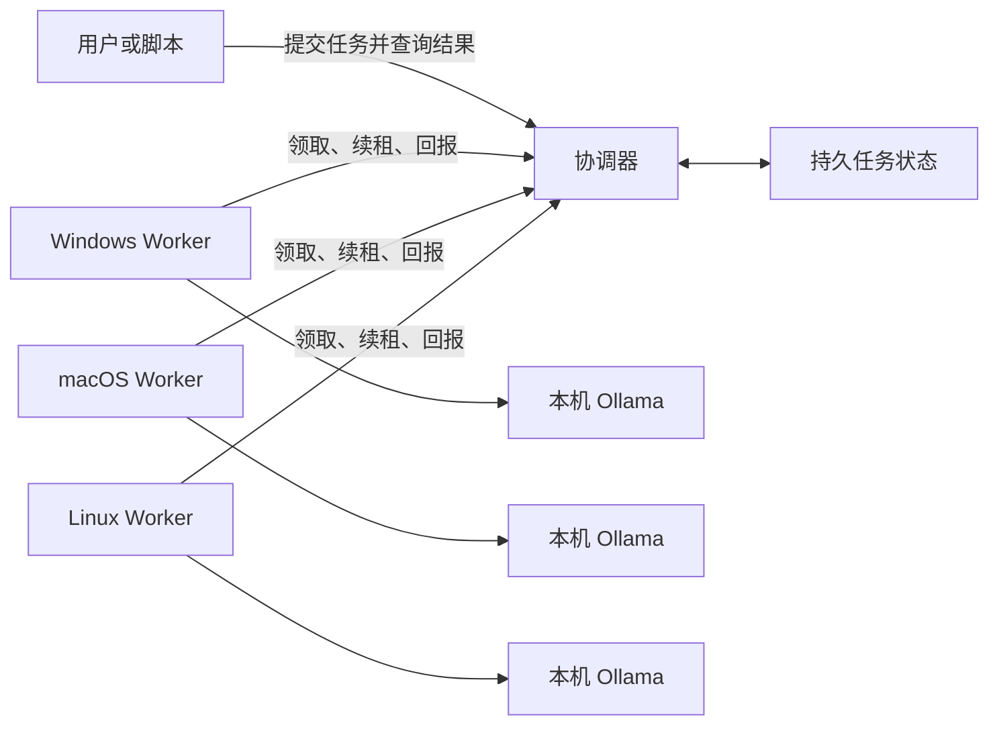

# 架构与实施路线

## 首版如何利用闲置电脑

IdleMesh AI 把每个文本生成请求作为独立任务。一台安装了模型的电脑用自己的 CPU 和内存完成一个任务，多台电脑同时处理队列中的不同任务。模型权重留在各节点本地，网络主要传输提示词、结果和少量调度消息。增加同模型节点可以提高批量请求的并发能力，并为故障重试提供候选节点。每个节点仍需要足够的内存装下所选模型和上下文。

Worker 主动连接协调器。只要 Worker 能访问协调器，参与运算的电脑就可以保留原来的入站防火墙设置。跨家庭或办公室试点可以使用双方都能访问的私有网络或 VPN。节点上的 Ollama 使用本机回环地址。 [Ollama API 文档](https://docs.ollama.com/api/generate)

## 任务如何恢复

1. 协调器将新任务写入本地 bbolt 数据库，客户端以任务 ID 查询进度和结果。状态包含已使用的尝试次数和最近一次执行的 Worker ID。
2. 空闲 Worker 从协调器领取与自己支持的模型匹配的任务。协调器给本次执行发放限时租约。
3. Worker 推理期间续租。如果电脑睡眠、退出或失去连接，协调器在租约到期后允许可用节点重新领取任务，直到用完尝试次数。
4. 新节点从原始提示词重新生成。协调器以当前有效租约判断是否接收结果，避免已经失效的执行覆盖新结果。

| 故障 | 首版行为 |
| --- | --- |
| 单台 Worker 下线 | 等待租约到期，由另一台拥有同模型的 Worker 领取 |
| 所有同模型 Worker 下线 | 已提交的任务保留，等待同模型 Worker 上线，受剩余尝试次数约束 |
| 协调器进程重启 | 使用原来的状态存储恢复任务，重启期间提交和查询会暂时不可用 |
| 协调器机器或磁盘丢失 | 依赖状态备份恢复。主机和磁盘冗余留给下一阶段 |
| 两次执行产生不同文本 | 客户端读取协调器接收的有效结果，生成文本可随模型和采样变化 |

租约提供的是任务级容错。单个请求的重试要重新计算，恢复延迟主要由剩余租约时间、轮询间隔和重新推理用时组成。超时设置需要给暂时的网络抖动留出余量。默认租约为 15 秒，每个任务最多尝试 3 次，Worker 每次推理默认限时 5 分钟。没有在线节点时，计算会暂停到节点恢复。网络故障可能导致同一任务重复计算，过期的租约无法写入结果。

协调器最多容纳 1,024 个待执行或执行中的任务。达到容量时，新提交会收到队列已满的错误。最后一次尝试的租约到期后，协调器会将任务标为失败。终态任务退出活跃队列，仍可按任务 ID 查询。

## 资源与数据边界

- 每台主机决定何时启动 Worker、安装什么模型，以及为本地推理预留多少 CPU 和内存。首轮试点从每台主机一个 Worker、小量化模型和短上下文起步。CPU 线程数限制推理并行度。可用内存还取决于模型、上下文和本机其他进程。
- 提示词和生成结果会经过协调器与领取任务的 Worker。协调器在任务完成或失败时从当前记录清除提示词，数据库旧页面和备份仍可能保留原文。结果保留供查询。按明文任务数据保护数据库和备份，首版适合同一家庭、实验室或团队等互信环境。
- 限制协调器监听和可访问范围。在跨设备场景配置认证并使用受保护的传输。模型下载由各 Worker 的运维者管理，按需核对模型自身许可和版本。
- 志愿者之间的隔离、节点身份和单独撤销、任务隐私、恶意结果校验需要独立的机制。陌生公网节点参加前，应先完成这些机制的设计与验证。

## 实施路线与验收

| 阶段 | 实施内容 | 验收方法 |
| --- | --- | --- |
| v0.1 可运行试点 | 单协调器、持久队列、模型匹配、租约回收、回显与 Ollama 后端、跨平台二进制 | 两个 Worker 完成任务。执行期间停止一个 Worker，确认同一任务由另一个 Worker 完成。带着待处理任务重启协调器，确认任务仍可查询和执行 |
| v0.2 家用资源治理 | 按 CPU、可用内存和用电条件暂停领新任务，展示节点容量、排队时间、失败原因 | 在日常应用启动、电脑切换电池或进入睡眠时测量前台影响、积压和重试次数 |
| v0.3 协调层高可用 | 可替换的共享状态存储、多个协调器实例、可撤销节点凭据、备份和恢复流程 | 停掉一个协调器实例，连续提交和查询，验证状态一致、旧租约隔离与服务切换时间 |
| 实验方向 | 只在稳定高速局域网试验模型分片，单独研究跨网节点可信度 | 分别测量单任务首字延迟、每秒生成 token、流量和断连代价，再决定是否继续 |

建议保留一组固定的短提示词和同一模型版本，用一个、两个和三个节点重复相同的批量测试。记录每分钟成功任务数、P95 完成延迟、故障后成功率及各主机内存峰值。使用真实模型测量推理性能，回显后端用于隔离验证调度行为。
